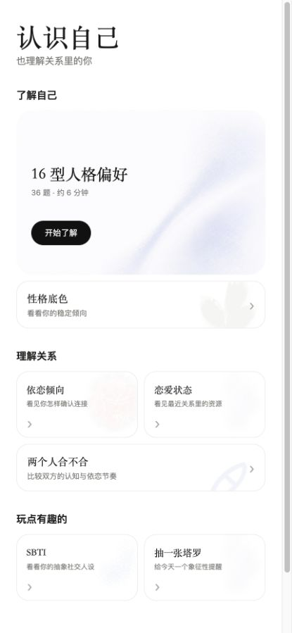
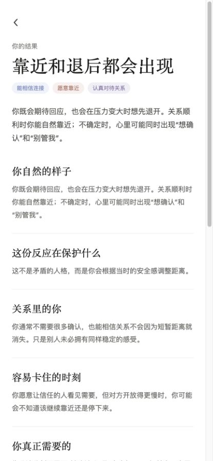
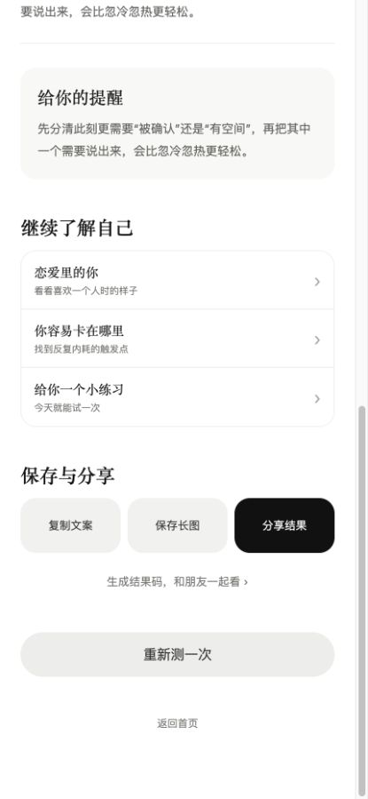
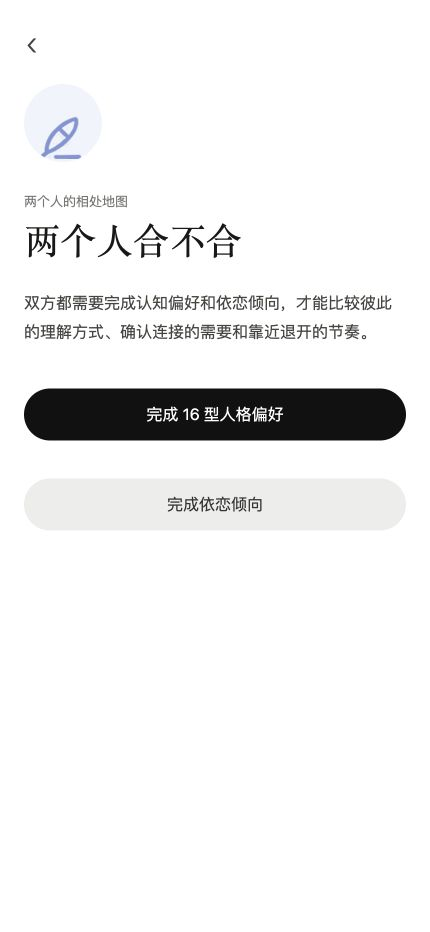

# 从“测试中心”到“关于我的答案”——产品方向审计

审计日期：2026-08-07  
审计范围：首页发现 → 单人结果 → 保存分享 → 双人入口  
用户目标：在很短时间内产生“这句话太像我”的感觉，并愿意用结果表达自己或邀请关系中的另一人参与。

## 总体判断

新方向成立，而且比继续修饰现有卡片更重要。当前产品的底层题库可以保留，但上层信息架构需要从“按量表分类”改成“按用户正在困惑的问题进入”。产品不是再卖一套测试，而是把用户说不清的感受翻译成一句愿意认领、愿意分享的话。

最重要的结构是三层：

1. **测量层**：认知偏好、依恋、关系资源等相对稳定的题库与计分。
2. **叙事层**：根据不同入口，把同一组数据解释成用户正在关心的答案。
3. **关系层**：分享卡、朋友眼里的我、两个人的相处说明书。

这意味着不需要为首页每一句问题都重新造一套题。多个问题入口可以复用同一套可靠题库，但输出不同的重点解读。

## 当前流程证据

### 1. 首页：健康度较弱

优点：结构清楚、视觉安静、正式测试与趣味内容已有分组。

主要问题：首页首先展示“16 型人格偏好、性格底色、依恋倾向”等产品分类。用户需要先理解这些名词，再判断它们能不能回答自己当下的问题。它更像工具柜，而不是一眼看见自己的地方。

建议：标题改为“最近，你在想什么？”，首屏直接出现 3–5 个具体问题；测试名称只作为较小的依据标签出现。第一批入口建议围绕：不敢依赖、失望后抽离、总在忍、越喜欢越想逃、突然不想联系。

### 2. 单人结果首屏：健康度一般

优点：语言温和，没有把依恋倾向写成诊断；已经有“保护什么、卡在哪里、真正需要什么”的解释框架。

主要问题：结果首屏是一份从上往下阅读的报告。标题下面立即进入解释，缺少一个能独立成立的“自我表达物”。用户虽然可能觉得内容合理，却很难从中截出一张完整、有记忆点的图。

建议：结果第一屏改成完整分享卡，顺序固定为：一句被说中的话 → 一个非污名化的人格意象名 → 3–4 个可读维度 → 视觉符号 → “查看为什么”。专业类型、理论依据和完整分析放在卡片下面。

### 3. 保存与分享：健康度一般

优点：复制、长图、分享三个动作已并排，按钮触达尺寸足够。

主要问题：用户滚过完整报告后才看到分享，而且在分享前看不到“我将分享什么”。这里优化了分享工具，却还没有创造值得分享的内容。

建议：第一屏结果卡本身就是分享预览；卡片右下只保留“保存卡片”和“邀请朋友看看”两个主动作。完整长报告继续留在下方，但不承担传播任务。

### 4. 双人入口：健康度较弱

优点：没有输出简单匹配百分比，要求双方数据完整，理论上更负责。

主要问题：用户在看到任何双人价值前，需要先完成 36 题认知偏好和 24 题依恋倾向，启动成本太高。它适合深度情侣报告，不适合微信里的第一次邀请。

建议拆成两个产品：

- **朋友眼里的我**：发起人完成核心测试后，朋友只回答 5–8 道可观察行为题；结果展示一致处、朋友更容易看到的一面、自己没说出口的一面。
- **两个人的相处说明书**：双方都完成核心题库后生成深度报告，描述各自需要、冲突瞬间和翻译建议，不提供命定结论。

## 必须守住的信任边界

1. 没有真实统计数据前，不展示“12.8 万人测过”。可以先用“最近常被问到”或完全不展示人数。
2. 没有常模样本前，不展示“在人群中的相似度 7.8%”。维度分可以写成本次倾向强弱，但不能伪装成人群百分位。
3. 不用“认知偏差 37%”制造精确感。朋友互动更适合写“最一致的地方”“朋友比你更容易看到的一面”。
4. 传播标题可以有情绪张力，但不要把人固定成负面身份。“慢慢收回期待的人”比“慢性抽离者”更容易被认领，也更少羞耻感。
5. 分享卡负责共鸣，完整报告负责解释。两者应来自同一套计分规则，不能为了句子好听而违背答案。

## 推荐的首页结构

首屏：

> 最近，你在想什么？  
> 有些感受不是说不清，只是一直没人替你说出来。

问题入口：

- 我到底是真的独立，还是不敢依赖别人？
- 为什么我不是突然离开，而是慢慢不再期待？
- 我是真的脾气好，还是已经太能忍？
- 为什么越喜欢一个人，我越容易想逃？
- 为什么我和有些人会突然不想联系？

下方再出现三个较小分区：深入了解自己、和别人一起看、轻松看一眼。MBTI、性格底色、依恋、SBTI、塔罗成为依据或工具，而不是首屏主角。

## 推荐的结果结构

1. **可截图结果卡**：一句话、意象名、四个维度、视觉符号。
2. **为什么会这样**：用 3–5 个短段落解释答案依据。
3. **关系里的具体表现**：靠近、失望、冲突、需要。
4. **一个可执行建议**：只给一个足够具体的动作。
5. **互动入口**：邀请朋友看看 / 和 TA 生成相处说明书。
6. **想了解得更深**：量表维度、理论依据、边界说明。

## MVP 优先级

1. 先重做一张“用户愿意截图”的依恋结果卡，并用现有 24 题真实数据驱动。
2. 再将首页从测试分类改为问题入口，入口复用已有题库。
3. 做一个“朋友眼里的我”5–8 题轻互动闭环。
4. 最后再扩展双人相处说明书和更多问题入口。

SBTI 与塔罗可以保留，但不应再与关系洞察争夺首屏注意力。

## 可访问性观察与限制

截图中部分灰色小字、标签和淡色素材存在对比度偏低风险；移动端正文也略密。按钮触达面积基本足够。仅凭截图无法确认键盘焦点、读屏顺序、动态状态播报和实际色彩对比值，仍需在实现后专项验证。
